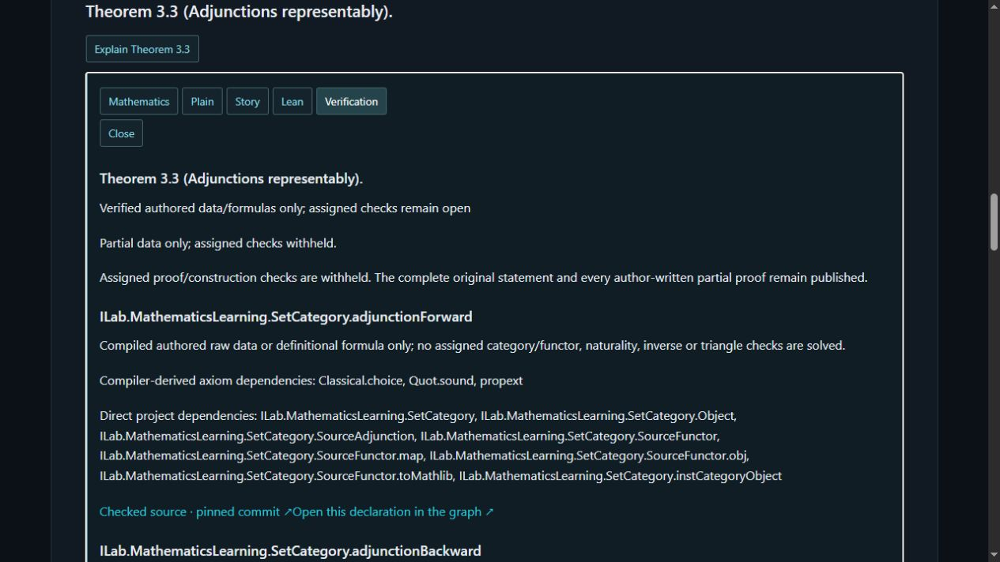

# G1–G10 live publication report — 19 October 2026

Release `learning-native-20261019-source-gaps-r13` is deployed and live verified. PR [#16](https://github.com/iontlab/geometry-of-intelligence/pull/16) was manually merged as `e157a6d257004688ebf5f6b37de6fed3981401c9`. The reviewed release commit is `e1dfad4c0fc4f7aadb25c75fef875e1565772ea9`; Lean source is pinned to `ebde0f04b46bc3cfa906d06b749e4954549f545c`.

## Approved repairs

| Gap | Published repair | Boundary retained |
|---|---|---|
| G1 / 1.15 | Existing category/functor encodings; identity and composite readbacks | Assigned category checks remain open |
| G2 / 1.17 | Opposite objects, homs, identities and reversed composition data | No new source category-law proof |
| G3 / 1.19 | Existing representable object/map declarations mapped to this source | Assigned functor well-definedness withheld |
| G4 / 1.21 | Typed postcomposition component and formula | Naturality withheld |
| G5 / 1.23 | Identity and vertical-composition components | Functor-category laws withheld |
| G6 / 1.28 | Reused composition; pre/postcomposition transformation components | Whole functor checks withheld |
| G7 / 2.2 | Reused G3/G4 Yoneda object and arrow assignments | Well-definedness/full faithfulness withheld |
| G8 / 2.6 | Reversed-composition readback only | Opposite-isomorphism premise remains assigned; independent Mathlib result distinguished |
| G9 / 3.3 | Forward/backward hom functions; unit/counit candidate components and equations | Naturality, inverse and triangle checks withheld |
| G10 | Section 3 introduction bound to the actual adjunctions source heading | Original source text unchanged |

[All 31 exact compiler-derived signatures and dependencies](new-declarations.json) and [per-item mappings and obligations](source-repairs.json) are retained alongside this report. No mathematical implementation was regenerated during deployment.

## Verification results

- Clean pinned Lean/Mathlib build: 8,962 jobs passed. Compiler extraction: 816 declarations, 427 authored declarations, 4,030 direct edges, 34 modules. Axiom/dependency audit, source-fidelity regression, exercise-scope and partial-Yoneda checks passed. No admitted proof or project-added axiom accepted.
- All 785 baseline declarations and 97 baseline narrative contents remain unchanged (including all 96 earlier upgraded records). Registry now contains 58 source and 45 graph records. Original manuscript/PDF, eight chapter sources, dependency pins, shared plugin entry point and RQ-001 remain unchanged.
- All 17 exercise markers, 15 exercise-affected items and 56 excluded complete exports are protected. Coverage remains 29 fully verified numbered items, 15 exercise-affected items and zero eligible pending items. Neither the complete Yoneda lemma nor representable adjunction theorem is claimed as source-verified.
- Offline release/graph checks passed; 28 navigation tests, 41 PHP integrity/isolation tests, 17 capacity tests and 750 local panel checks passed. Exact final command output is in [PR verification](pr16-final-verification.json).
- Live browser: 290 source-panel checks, 225 graph-panel checks and 235 inline-panel checks passed (750 total). All 139 distinct declaration deep links and the scope labels on all 31 new declarations passed.
- All 46 public asset hashes match; 37 are unchanged. The deployed 7,389-byte PHP source was read through authenticated WebFTP View and exactly matches SHA-256 `c8691cb0211bb55b6604da9e31b6e4413c26c1a4cb338f05e55631f08180471d`.
- Eight anonymous chapter bindings, fresh nonce responses and raw-source hashes passed; eight authenticated editor bindings match their exact recorded fragment hashes. Both published metadata pages match the approved drafts exactly after line-ending normalization. G10 points to the verified adjunctions heading.

Registry size is **503,551 UTF-8 bytes**, including signatures, bindings and scope metadata. The configured limit is **5,000,000 bytes**, leaving **4,496,449 bytes** of headroom. SHA-256: `113d18391c7e3b368b9bcd1f695b7818ed514a49d598d74ac6b2ed17b61aa5b6`. No content was shortened to fit. Existing bounded reads, integrity, freshness, ACL, schema and record checks remain enforced. Capacity growth guidance is in [README](README.md); no architecture redesign was introduced.

## Live examples and evidence

- [Theorem 3.3 verification](https://iontlab.org/formalization/mathematics-learning/?statement=3.3&layer=verification)
- [Construction 1.19 verification](https://iontlab.org/formalization/mathematics-learning/?statement=1.19&layer=verification)
- [Corollary 2.6 verification](https://iontlab.org/formalization/mathematics-learning/?statement=2.6&layer=verification)
- [Published verification page](https://iontlab.org/doku.php?id=mathematics_learning:higher_category_theory:synthetic_category_theory:verification)

See `publication.json`, `live-integrity.json`, the three live panel files, `live-declaration-links.json`, `live-new-declaration-scopes.json`, `live-final-checks.json` and `live-php-readback.json` for machine-readable evidence. Independent human mathematical review is not claimed. No unrelated content changed.

